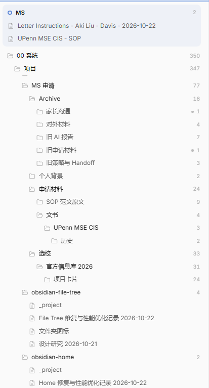
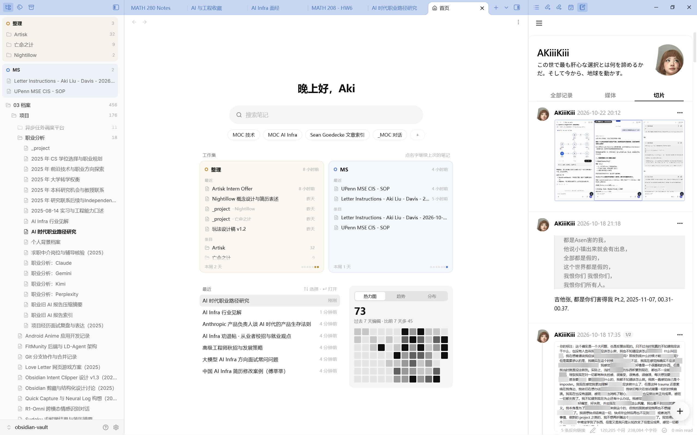
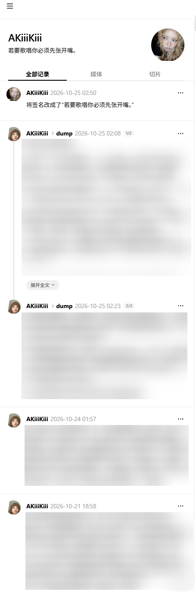

### AI 相关的一些阅读和思考

- 我一直都很欣赏 [Linear](https://linear.app/) 的设计和他们的团队。我在 10 月 21 号曾经思考要不要再次使用 Linear 来管理我的一些进度，但后来感觉，Issue 和 PR 这种软件工程、多人协同的思维模式，和我现在一个人做所有事情的逻辑不太一样，使用 Linear 又有点过度工程化了
- 我之前曾经使用 [Calibre](https://calibre-ebook.com/)，开源的电子书管理软件，编辑过一些 epub 文件。我这周在推特上好像又刷到有人用这个软件了，我又想起了他老掉牙的 UI，实在是太丑了，有点太老旧了。于是我跟 ChatGPT 讨论了一下重做这个 UI 的可能性，感觉并不是不可能。但是我并没有做，因为我觉得目前没有太大的需求。如果有人有精力或者有这个需求的话，赶紧重新做一个吧
- 稍微调研了一下 T3 code 的 provider 切换、context handoff、swarm 架构，并且比较了一些主 Agent + worker 组合。他的这个功能确实是挺好用的啊。我用了 T3 code 之后，我基本上没有再打开任何一个 agent harness 的官方客户端了。这个团队迭代得确实快速，并且它的 remote control 确实好用啊。我已经很久没有再打开 Codex 或者 Claude 了。前段时间打开的时候，发现它们的 UI 都变了很多，性能也有一些提升了。之前用 Codex 的时候，老是因为长对话，切换的时候直接把电脑卡得啥都动不了，现在应该这个问题少了吧
- 稍微研究了一下 formal verification。虽然我身边一直都有在做 formal verification，我的教授和组里的 PhD 他们都有在做各种 formal verification 的东西，但是我其实一直对这个领域并不是非常了解。我简单看了一下 [Anthropic 发的关于 formal verification 的文章](https://www.anthropic.com/research/formal-verification)，没有时间仔细阅读它，但是大概理解了一下这么做的理由。我们 systems group 也有对这个方向进行一些讨论。有人说，由于他需要花费数亿的 token，所以其实跟之前人工时代没有本质上的区别，对软件进行 formal verification 还是需要巨额的成本；有人认为和安全问题的成本相比，token 成本要低得多。并且它绝对是一个今后非常有意义的方向。只不过它也有它的局限性。在这篇文章中，有这么一段话：
  > **“经过形式化验证”并不意味着“没有 Bug”。** Claude 可以编写一个证明，表明编译后程序的行为符合 formal specification 的要求，而这个证明会由外部的 proof checker 进行验证。然而，证明检查器无法判断你的规约是否与现实相符。要准确反映现实，规约就必须正确涵盖并建模经过验证的程序所运行的真实机器的所有相关方面，包括 CPU 和操作系统。当经过形式化验证的代码仍然出现 bug 时，原因就在于规约或对机器语义的假设与现实存在偏差。幸运的是，这也意味着我们知道应该去哪里寻找剩余的 bug，以及如何设计一个系统，将这些仍然可能存在 bug 的薄弱环节尽可能缩小。
- 这周跟 agent 协同工作的时候，经常使用受 Felix Rieseberg 的[文章](https://felixrieseberg.com/how-to-be-more-ambitious-a-tutorial-for-humans-with-models/)影响的一个 prompt，感觉确实能拔高 agent 的思维上限：
  > 动手之前，先帮我把这项任务做得更 ambitious。
  >
  > - ALTITUDE（高度）：说出我真正想要的结果，不止于我字面上的要求。
  > 再给出一个针对这个结果的任务版本，列出你需要哪些权限或设置（日志、分析、测试设备、脚本），好让你能独立推进、自己验证，不用我介入。
  > - DEPTH（深度）：这个领域的顶级从业者会做哪些我没要求的事？他们会从哪些原始材料入手，用什么工具和方法（性能分析器、测试框架、遥测、统计分析等）？再给一个听起来不现实、但能做到的目标。
  > - RANGE（范围）：把任务改写成动词，不要写成名词，说清它到底要为使用者做什么。列 3–5 个软件之外的领域，看它们会怎么理解这件事。每个领域给一个你会真正用上的具体技术，不要角色扮演。最后加一个对抗视角，专门找这套方案的漏洞。
  > - VERIFICATION（验证）：定义怎么算成功。标准不能是你自己的判断，要用 test、benchmark、profiling，或者你能跑一遍并检查的真实用户数据。
  >
  > 然后按这些要求重写我的任务提示，动手前先等我同意。
  >
  > 我的任务：[在此描述]

---

### 重新设计了 obsidian 的文件列表

由于 obsidian 的文件实在是有点多，就算用了 file tree alternative 这个插件也不能很方便地 navigate，所以我就心血来潮开发了一个自己的 file tree 插件。跟原生的文件列表和 file tree alternative 比起来，我自己的插件可以做到：

- 上级文件夹吸顶，滚远了仍看得到所在层级
- 上方工作集能放一些我暂时需要频繁使用的笔记和文件夹，不用每次都在整个文件列表里翻找
- 超过 30 个文件的文件夹会先显示 10 个，点击“全部”后再显示全部
- 日期型文件夹自动按年、月分组，不会直接平铺所有文件

设计这个插件的时候完全是符合自己的需求来进行的：
- 我自己主要靠点开文件夹找笔记，不靠搜索，所以我完全没做文件夹层面的搜索功能
- 不同工作集并列显示，因为我经常切换工作任务
- “全部展开” 功能默认只展开到子文件夹，不展开文件夹里的文件，不然可能会显示得过长
- UI 设计从简，紧凑优先，方便浏览

我现在针对任何软件层面的高频痛点都想要配合 agent 来创建一个 solution。我这周花了可能也就两三个小时在这个东西上面。用两三个小时以及一些 token 来换我之后工作时的顺手和舒服的体验，我觉得完全值得。

---

### 优化了 obsidian memo

一些前情提要：
- 我在六年级的时候就开始捣鼓并使用笔记软件。在那个时候，有道云笔记和印象笔记是比较火的两个软件。
- 再之后，[Notion](https://www.notion.com/) 和 [Obsidian](https://obsidian.md/) 几乎重新定义了笔记软件这类产品的两个方向：
	- Notion 这类笔记软件是面向企业的端到端协作平台，拥有完善的开箱即用的功能和各种集成，重点在文档和项目管理
	- Obsidian 这种就是更加小而美，基本功能更简单，更本质化的本地优先软件，它提供的更多是一个基础设施，但会给用户保留高度的可定制性
- 那个时候的我同时使用 Notion 和 Obsidian 两种笔记软件，它们各有不同的 use case，我一般使用 Obsidian 进行日常记录以及一些写作，同时使用 Notion 进行项目管理以及一些对外展示的文档。正好那个时候，双链笔记和[卡片笔记法（zettelkasten）](https://zettelkasten.de/introduction/zh/)也在科技产品圈内风靡起来，大家都在讨论应该怎么样提升自己的 productivity。我一直有不断关注这个圈子的趋势。
- 那个时候有一个比较知名的 PM [刘少楠](https://www.linkedin.com/in/plidezus/)，他发布了一款自己的产品叫 [flomo](https://help.flomoapp.com/)，我暂时对这个产品不做更多的评价。简单来说，他是想做一个类似发微博一样写笔记的工具。我那个时候正好想找个地方写碎碎念，所以使用了一段时间这个产品。
- 后来我觉得这个产品非常的差，因为它的所有的数据和功能都非常封闭。它跟很多其他笔记软件有同样的问题：当用户想从这个笔记软件中迁移走时，它会想方设法地拦着你。就比如它不支持 markdown 导出，只支持导出为 html。这样导出过后的笔记就不是一个个清晰的文档文件，而是只能用它自己做的这个 HTML artifact 来打开它。现在有了 AI Agent，你可以很轻松地把 HTML 文件转换为 Markdown 文件，然后导入到其他笔记软件，比如 Obsidian 中。但是在没有 AI Agent 的年代，编辑和处理 HTML 的体验非常差，不仅耗时耗力并且也比较困难。
- 我后续又辗转了很多个笔记软件记录这种碎片的想法，但主要还是会记录在 Obsidian 的 daily notes 中。但是很难整体地浏览我的这些碎片想法，因为它们散落在各种不同的文件中。
- 我后来（大概是 26 年 2 月）发现 Obsidian 中有一个叫做 [Thino](https://thino.pkmer.net/en) 的插件，它复刻了 flomo 中的主要功能和 UI，但他写入的笔记数据会直接存在 Obsidian 的 daily notes 中，所以处理和迁移笔记数据非常轻松，笔记的数据也时刻掌握在自己的手中。我用这个插件用了差不多快半年。但是后来就实在有点不太想用这个插件，因为它有一些关键的体验上的问题：
	- 长文不会拉高输入框，只能在那个类似微信输入框的小输入框里编辑
	- 写完卡片后，不能直接在卡片上编辑文本，还是会跳转回输入框编辑
	- 往下滑动的时候编辑框不会收起来而是会一直固定在上面占用空间
	- 有很多我不需要的别的功能，比如说日历啊，高级检索啊，分享啊什么的
	- 我是使用 Obsidian 的 [NotePix](https://github.com/ayushparkara/notepix) 插件把我粘贴到笔记中的图片自动上传到 GitHub，然后用 GitHub 进行云存储，这样就避免了我的笔记库因为附件太多而膨胀，但是由于我上传的是 private repository，所以没有办法在 Thino 的媒体库中显示。我自己可以和 agent 把这个问题改掉。但是 Thino 一更新，又会覆盖掉我原来的修改
- 我受够了让别人开发我想用的东西，就算我提了意见，也要等他们采纳，或者说服他们采纳。
- 我决定自己来写这个插件。和体验稀烂的 Thino 比起来，我感觉  [Threads](https://www.threads.com/) 的浏览体验很好，手感非常好，性能也非常好，整个书写和发送的流程都很爽快。我最开始的需求是想要随时随地记录，体验接近发 Threads，在 Obsidian 里也能方便地浏览，并让数据安全、私密地存在我自己的 daily notes 里。经过了一段时间的开发，我的插件现在基本能够满足我的所有需求。
  

再次优化了自己在 obsidian memo 中的性能和布局。之前点击不同栏目的时候会卡顿一下再切换过去，并且加载图片类媒体会比较缓慢。于是我做了一些性能上的优化：
- 卡片高度从“渲染一张、测量一张”改为集中测量，避免布局的重复计算。栏目切换阻塞由 0.4–0.95s 降到约 0.1s
- 相册改用缓存缩略图，避免反复处理原图。媒体切换的阻塞由通常约 0.13s 降到约 0.03s
- 修复了切换栏目后的闪烁和卡片重叠

继续优化了一些 UI 元素，比如整理和精简动画效果，按钮样式，下拉栏样式，icon 样式，并改善编辑框样式，长文显示样式，筛选页面样式等。

现在整体使用体验已经基本没有我能认为可以说是比较难以忍受的地方。

---

### 优化了 Obsidian 中的图片查看功能

事情起于我在编辑一篇文章的时候，想要去修改图片的 caption。在 Markdown 中修改图片的 caption，需要展开图片源码，然后在源码中添加 caption。但是我在编辑这篇文章时，发现我无法展开图片源码。并且 Obsidian 的图片查看好像一直都挺有问题的，它的点击查看大图功能一直不能在我的设备上很好地 function，我也不知道是因为插件有冲突还是什么。别人做的 Image Toolkit 对我来说也有一点粗糙，而且功能也不一定符合我的需求，我觉得我还是有必要去优化一下。我完成了：

- 修复原地无法编辑源码的问题
- 修复编辑模式下图片宽度溢出的问题
- 修复点击图片时图片显示在到底部的问题
- 修复外站图片无法复制的问题
- 做出完整的图片查看器，并实现缩放、平移、旋转、原尺寸显示、复制和同篇图片切换等功能

---

### 改进一下个人网站

这个 website 我在五六月份做了差不多之后，就基本上没有怎么再更新过。这次按最新材料稍微更新了一下首页、Resume、Courses 和 About，统一 Artisk 实习信息。

删掉了之前用 AI 帮我整理的很多 notes。这些基本上都是 course notes。大段大段 AI 写的文字我自己也没有看过，虽然是用我自己的材料和笔记整理的，但我认为还是不要在我的网站上放出来让别人找问题比较好。但是我保留了一些我自己写的 notes。

还有一些别的改动：

- 优化了加载与显示：缩小了图片、减少了字体请求，并将列表预览改成按需读取共享数据
- 稍微调整了部分样式：按页面拆分了 CSS 和脚本，统一深色模式、标签名称及部分移动端样式
- 修复了搜索、标签筛选、微博加载、返回前进和网址冲突等问题
- 清理了重复样式与注释并删除暂时不用的本地写作工具

---

### Digital Hygiene

- 整理了电脑的 D 盘和 I 盘，让一些散落的文件归位，并且再次审阅了电脑中所有已安装的软件和可执行文件，删掉了所有不用的。
	- 我一般下载的工具和软件会直接安装到 D 盘的 Apps 文件夹中，但之前安装一些程序的时候，直接安装到了 Apps 文件夹里面，导致 Apps 文件夹根目录下有很多我看不太懂的 `.dll` 文件，还有一些配置文件、缓存文件、数据文件等等。我这周全用 agents 把它们整理并归位了一下。现在这个文件夹中没有散落的 `.dll` 文件了。但有一些字体文件还不确定它们的 dependency 是什么，所以没有完全整理完。
	- 卸载了很多以前不用的环境和配置，比如 Anaconda、SBCL、JDK，以及一些不用的工具，比如 pandoc、旧键盘（Ducky one 2 mini 方向键） AutoHotkey 键位映射的配置、Glorious Core 等等。
- 把非常非常多其他地方的文档整理进我现有的 Obsidian 库中，包括以前的 Gemini 和 AI Studio 对话，以及以前在 Notion 和 Anytype 上的所有笔记。
	- 筛选了 158 篇 Anytype 导出的 Markdown 文件，保留了 85 条笔记的内容，合并并整理后新增了 29 篇文档并补充了 11 篇已有笔记。迁移后，将 9 张图片上传到 NotePix 并更新了引用。
	- 筛选了 5039 条 Gemini 活动记录，保留了 359 条笔记的内容，合并并整理后新增了 70 篇笔记。后续把图片、文档和 JSON 中的内容展开到正文，整理分类并清理了重复附件。
	- 优化了这些笔记的格式，包括修复错误显示的格式，将 ASCII chart 替换为 mermaid 流程图，并把整体笔记清理得更易读等。

---

### 杂思

在小红书上刷到一篇写 2026 年流行文化的“回归生活”的趋势。感觉说的还好，但是到后面又开始引用项飙和韩炳哲了。为啥搞社科的就顶着项飙和韩炳哲不放啊。项飙最近一段时间复读他的“附近”的概念有点复读得太多了吧。我感觉韩炳哲其实写的东西倒是挺好的，我看过他的《倦怠社会》和《爱欲之死》，我觉得写得其实不错。项飙的话，我没有仔细地阅读过他的作品，但我觉得韩炳哲实在是有点被滥用了。我感觉很多人特别爱什么都往他们身上套，就跟一些网哲一样，喜欢把什么都往齐泽克、拉康身上套，有点现实成了理论的例证的感觉。我之前也是特别喜欢把什么都往鲍德里亚、阿甘本身上套，但是感觉不能理论先于观察。现在我几乎不会特别生搬硬套了。感觉很多中国的一些学者真的喜欢滥用理论来让自己看着很新潮，尤其是在写游戏批评或流行文化批评的时候，看着真的很累。

---

最近感觉 ai 真的和毒品一样。每天看着新的 ai 新闻，自己也用着 ai 做一切事情，有一种日新月异，兴奋感和新奇感爆炸的感觉；但是把目光移开看看发生在现实世界的一切，或者看看现实世界 新闻，又或者是尝试不用 ai，就会愤怒、低落又疲惫。感觉一切都是可能性，一切都是令人期待的，但这些都是未来的，实际的一切都又好像已经坍塌了。真无聊。

---

最近越是想睡着，就越失眠。越明白尽量不要责怪自己，就越忍不住去想“不能责怪自己”这件事，最后就越是责怪自己。我就这样在这种愧疚中恶性循环。

感觉偏离我控制的一切琐事，任何工具上的，人际上的，情绪上的没有被解决的事情，都会慢慢堆积在我的心头，而我仍没学会怎么放着他们不管。我完全无法容忍自己不知道为什么，也不知道该怎么办的状态。

所以我到底怎样才能让我不再问“我到底怎样”？

---

有时候我会有很高的效率。我几乎不停地并行操作三四个 agent，不断切换窗口，每过一会儿就 review 不同的东西。这样确实在更短的时间里干更多的事情了。当我回想起我刚刚都干了什么的时候，当我查看 agent 的 CoT，它们的 tool call sequence 以及输出的时候，我总能有一种欣慰的感觉。我干了这么多事情。当我看到那些经过我和 agent 共同雕刻出来的结果的时候，满足感油然而生。感觉我好像踏上了一个飞轮，这个飞轮的语言是快节奏，高吞吐，高并行。

但我也同时会有一种头脑被榨干了的感觉。我在进行长时间的高强滴认知型任务的时候就会有这种感觉。它是一种有些平静，有点开悟，甚至近似抑郁的感觉。我不知道这是疲惫，过热，还是什么。我没有兴奋感。如果我真的完成了很多事情，那我或许会如释重负，但如果我没有的话，我只会有一种混合了空虚，自责，疲惫，茫然的复杂感觉。

我想，如果以后工作了，被压榨，被 pua，披着夜色回家，回到家之后只能面对一面面白色的墙壁和静止的物件，应该会挺不好受的吧。

谁知道呢。如果回到家之后还要被人打扰会不会更不好受呢。

---

### 生活和其他

- 在 Lichess 尝试入门 chess。进行了 7 把真人对局，无一例外全部败北。但我又在思考要不要自定义 Lichess 客户端
- 稍微看了一下 Ann Demeulemeester 近几年的秀场。感觉一直都挺好看的，但是可能是因为风格一直太统一了，所以没有什么新奇感
- 这周攀岩又爬过了若干条 V3 的线路。感觉现在的水平基本上是 V3 级别，之后可以冲一下 V4
- 这周时隔 12 天重新健身了，健完身的酸痛感还是很舒服的感觉。看着自己身材越来越好，确实是一件很惬意的事情。如果世界上所有事情都能像健身一样，做了就会有比较能察觉到的回报就好了
- 这周 S 赛开打了，我将会看完炫神的所有 S 赛解说
- 这里有一篇[很精彩的写田柯宇事件的文章](https://mp.weixin.qq.com/s/P9aWfHyeUMw7DAkmyk02CA)
- 这周彼得严又一次判定击败了梅拉布，卫冕了 UFC 男子雏量级冠军。宋亚东的夺冠之路又受阻了
- 为 MATH 208 的 midterm 复习了 simplex, duality, complementary slack 等内容
- CSC 290 开始学一些更深入的内存和程序相关知识了，感觉都没啥时间深入研究它。最近真的事情太多太忙了，有无数的事情和 ddl 等待着我，还有 MATH 208 的 midterm，还有申请的 ddl，下下周还要给我的 research 最终的收尾（give a talk on systems seminar），感觉啥都追着我跑，真的又累又崩溃啊
- IVE Looks Can Kill 真的杀疯了吧。
  
- 随便制作了一个 在 Muse 中可以使用 personal workspace，主要是便于我在 Muse 中查看 todo 和 calendar。
	- 我觉得直接在 Muse 中构建这个 artifacts 很丑，所以我把它打包出来用 Claude 构建，随便制作了一个 demo，之后打包发回给 Muse。差不多随便制作了一个 demo，之后打包发回给 Muse。我之后可以通过跟 Muse 进行自然语言对话，来给这个 artifact 添加或完成任务。只不过有时候跟他对话时，他会忘记自动添加进这个 artifact，所以我现在使用这个东西的频率还不是很高。
- 这是我写的第一篇 weeknotes，花了差不多两小时吧。还挺累的。该睡觉了。

> 若要歌唱你必须先张开嘴，你必须有一对肺叶和一点儿乐理知识。有没有手风琴或吉他倒无所谓，要紧的是有想要歌唱的愿望。那么，这儿便是一首歌，我正在歌唱。
>
> **亨利・米勒，《北回归线》，第一章**
