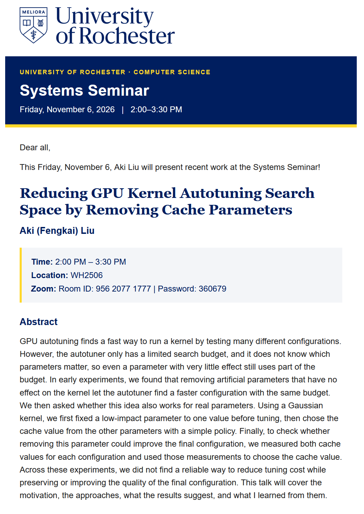

## Research Talk 准备

炼狱的一周。我现在也是 11/16 的时候再回顾这一周。我几乎不记得这周干了什么，但这周基本上就只有一件事，就是准备我的 Research Talk。研究本身的内容整理在 [Research 全流程整理](/notes/gaussian-autotuning/)。

### 11/3 下午 - 11/4

周一周二已经连续两天晚上一点都没有睡着，真的抑郁得不行。虽然没有什么很痛苦的想法，但就是有一股莫名其妙的郁闷感。周三我开始冲刺理解整个 summer research。我不断询问 AI 一些指标（比如成本，一些数字）究竟具体是什么，发现一个名词可能在不同 experiment setting 下指代不同意思。这里的东西太多，我有点 follow 不过来。由于我在回溯地理解一切，所以我并不是“从记忆中回忆起实验的过程和决策”，而是“幻想一个记忆，替当时的自己补上实验的决策”，因为当时很多都是 AI 带着我 research 的，我是比较似懂非懂的，现在却要自己把每个决策讲清楚，我发现难度真的很大。

自己写出来研究问题，以及三个实验的大致过程和结论，真的感觉一切都好崩溃。不知道自己要掌握到什么程度，真的被问出 ptsd 了。有时候问 AI 一个东西，它却又给我倾泻了无数的信息和细节；但是让它精简一点，却又会缺斤少两。在这无效的沟通中也磨灭了不知道多少心智。

---

### 11/5 - 11/6 早上

这是最 grind 的一天。我让 AI 给我可视化讲解，然后自己写了 autotuner 循环，测量流程，模板参数等一切东西的定义。到傍晚我终于开始做 slides，随便挑了个 metropolis 的模板，然后就开始做。

slides 其实一直做到早上六点半什么的。我发现做 slides 和 practice 自己在那 talking 花的时间不一定比整个理解的过程少。尽管我感觉我好像已经整理并理解出来了整个流程，但是流畅、清晰地表达出来还是太困难了。太困难了。

就算到这个时候，就算到要 talk 当天，我很多结论数字还是不太熟悉，也没有特别熟悉它们怎么分析的，只是比较理解。代码我也基本不太熟悉。说实话，真的有人特别熟悉自己的 research 代码和数据都在哪，可以随时 pull out 吗？但是却又感觉不熟悉这个有点说不过去。

到最后，我还是觉得我的内容有点少，可能有点不够支撑这个 talk。因为我印象里的 talk 可能都是大半个小时之类的。但其实好像不用花那么久。

中间有一小会儿我实在是受不了了，盯着电脑屏幕的时候都在眩晕，感觉头脑 physically 涨得发懵了，脱力地在床上盯着天花板躺了会儿。但是心里的焦虑不允许我就这样昏昏睡去，所以过了几分钟又爬起来继续 practice。炼狱期。这时候真心觉得这是 probably the hardest thing I have ever tried。

六点多睡到十一点多，早上看到 Jingyu 的 feedback，又临时改了 slides，加了一些东西之类的。

---

### 11/6 真正 Talk 的时候

迟到了一分钟，然后 setup 花了十几分钟，结束了才真正开始讲。一开始是直接 share screen 到 zoom，我本来都有点想硬着头皮不看 notes 讲了，幸好还是问了一句 am I able to see the notes while sharing my screen，然后就又 setup 了很久，让大家等了挺久。总共讲了大概二十分钟，QA 持续了十分钟左右。我其实都没有想到有人能跟上或者听懂我在讲什么，但是实际上这个内容好像也已经完全没有复杂的部分了。我把容易出岔子的复杂的东西都砍掉了。大家的问题至少说明了，大家已经跟上了我的 method 和 result 然后在思考，没有出现大家不理解我在研究什么的情况。我先前担心的可能要现场打开代码什么的，都没有发生。

我其实已经不在乎内容了。能让人理解就已经够了。大概的机制，流程什么的都讲了。就差不多照着 notes 读。读的时候稍微有点磕磕绊绊，很紧张，但没有大差错。小细节什么的都无所谓了。虽然讲得还是一塌糊涂，还是完全不能说得上好，什么都有充足的改进的空间，其实差不多了。我已经累了。我已经不行了，我不再苛求更多了。

平稳落地的时候我快哭出来了。我后面真的腿都软了。自己讲完后看 Alishba 在 talk 的时候啥都听不进去。

感觉一切都结束了。真不可思议，一切都结束了。如释重负。

---

## 要就做就做另类王

我本来就听[卡布奇诺](https://www.youtube.com/watch?v=tnIzf-wrlHg)听了好一段时间了。在 11/7 的夜晚，我突然理解精神小伙，突然理解喊麦。如果你不听王斩那你不要和我说话。

献上两首。

> [压声你都压不稳](https://www.bilibili.com/video/BV16U1uB6Ejb/?spm_id_from=0.0.search-card.all.click)
> 压声你都压不稳 咬字你都咬不狠
背叛师门忘了本 泛滥之徒给我滚
呐喊压声有多猛 我喊遍整个东三省
点将台 梦已醒 我斩妖孽 我血翻涌

> [寒芒纵云渡](https://www.bilibili.com/video/BV12Qwuz4ErD/?spm_id_from=0.0.search-card.all.click)
> 寒芒 纵云渡
向天迈三百步
别妄想将我束缚
这一招你接不住
雨沾衣 血沾刃
寒江上剑光论
江湖上多少立棍
为何我是独一份
刃上霜 斩乱麻
封喉决 透骨划
多少人自称侠客
随后就被断生涯
红尘事别想念
练世间最强剑
待此处风云现
我陪你飞升上上界

---

## Chunqiang Tang Talk

除此之外，我周三还去听了 [Chunqiang Tang（唐春强）](https://sites.google.com/site/tangchq) 在 graduate student lounge 的一个小范围 meeting。

他作为 Vice President of the [AI & Compute Foundation organization](https://aisystemcodesign.github.io/acf.html) at Meta，发表了很多关于 PhD，学术，已经工作相关的看法。

他主要说的就是，打好基础、做出能证明能力的成果，同时了解行业变化，但不用试图提前几年押中下一个热点。我有一些从他的谈话中总结出来的东西：
- 加入 startup 这种高风险高回报的事情尽早做，等到结婚生子之后机会成本就更高了
- 他个人仍倾向招聘 new grad PhD 而不是 experienced engineer，因为 experienced engineer 可能在一个舒适圈待的太久，外加 AI 抹平了一部分他们在经验上的优势，但是 new grad PhD 更接近研究前沿、且学习意愿强
- LLM/MLSys 岗位多但竞争极为激烈容易供过于求，小众方向不一定会有这种情况
- ML Compiler 专家的需求已经爆发，因为现在各家都在做自己的 chip
- 即使 PhD 的具体研究最后没有实际用途，身为 PhD 受到的训练仍有价值
- 招 new grad PhD 时，大方向符合的情况下论文质量更重要。如果不是 new grad，具体领域和项目经验会变得更重要

---

## Log

下面是我的一个比较详细的 log，稍微涵盖了一些我的项目的进度：

### 申请

- 将 UChicago MPCS 的 Career Goals Essay 定稿并提交申请
- 创建 `ms-admissions-strategy` skill，用来分析项目和申请材料的匹配度

### 项目记录

**个人网站**

- 清理了网站代码和资源，优化字体加载，并调整手机端布局和菜单
	- 删除无引用的资源和样式，整理模板、标签、导航、文档和配置
	- 给字体做子集化，修复字偶距、边界框和裁轴带来的显示差异；保留影响显示效果的部分变量轴和 hinting
	- 增加代码块的复制代码按钮
	- 修复手机端 Resume、Courses 的边距，以及 Dashboard、年份对齐和菜单延迟问题

**Memo**

- 调整了记录卡片的动效和样式，优化数据处理，并整理了代码和测试
	- 删除记录后让下面的卡片补位，支持系统的减少动效设置
	- 修复侧栏隐藏时仍在测量造成的列表位置异常
	- 调整索引和数据布局，保留测量中有收益的改动
	- 拆分宿主、日记写入、Feed 状态、上传、标签和看图模块
	- 修复编辑时标签面板被后面的卡片遮挡的问题
	- 样式对齐 T3，修复 Link Flair 图标误用正文图片样式；中文字体试用后撤销

**Home**

- 完善了 Home 统计卡和常用笔记的交互，也减少了搜索和界面的重复工作
	- 统计卡增加关联笔记、固定日期、键盘导航和图形入场，调整卡片外框、切换闪烁和左栏布局
	- 固定或取消固定笔记时不再额外查询 Omnisearch
	- 调整搜索数据布局，并对照检查结果、排序和分数
- 升级到 TypeScript 7.0.2

**File Tree**

- 给 File Tree 增加当前行高亮的滑动反馈，也减少了工作集重画时的测量
	- 当前行变化时，高亮滑到新位置
	- 工作集只有零行或一行时，跳过不必要的位置读取
- 升级到 TypeScript 7.0.2

**Image Kit**

- 完善了 Image Kit 的看图体验，可以查看笔记中屏幕外的图片
	- 从笔记源码获取完整图片列表，支持屏幕外的 NotePix 图片
	- 加入双指缩放，修复 callout、表格和列表中的图片行为
	- 删除功能重复的按钮
- 升级到 TypeScript 7.0.2

**NotePix Gallery**

- 把 NotePix Gallery 做成 Obsidian 插件，可以直接在库里浏览和管理图片
	- 加入侧栏入口、画廊标签页、主题适配和本地服务管理
	- 关闭最后一个画廊标签页时停止后台服务
	- 修复不带 `@branch` 的 jsDelivr 链接中断扫描的问题
	- 删除图片前重新扫描引用、在服务端复核，并保留本地回收备份

**OptMem Console**

- 把 OptMem Console 改成卡片式界面，方便查看和搜索记忆
	- 合并搜索入口和库切换，拆分记录读取与编译流程
	- 修复中文库名导致的缓存文件名问题

**Backlinks**

- 创建 Backlink Excerpts 插件，在反向链接中显示相关摘录
	- 完善来源路径、高亮、资源释放和异步刷新
	- 修复来源文字变化后仍显示旧摘录的问题

**Meeting Transcriber**

- 优化了中文转录速度：同一份约 256 秒录音的单次对照中，从入队到完成由 68 秒降到 39.5 秒，输出一致
	- 语言检测后再加载需要的模型，去掉中文任务提前加载 Parakeet 的开销
- 整理并重构了转录器代码
	- 统一部分路由、任务状态和音频解析
	- 把转录工作进程拆入 `pipeline/`，后台任务和接口放入 `background/`，插件改为读取 `api_port`

**项目理解**

- 系统梳理了 Project 文件夹里的所有项目，简单理解一下它们的整体架构、运行流程和设计

### 收藏、笔记与环境

- 清理旧 worktree 和临时文件
- 优化 PowerShell 和 CMD 的启动
- 继续整理技术收藏
- 调整 Obsidian 正文、引用、代码块、表格和图片样式，修复图标、图片说明和嵌入内容的问题
- 调整了 Obsidian 的侧栏交互：开关文件列表或文章目录时，正文保持原位，侧栏仍保留滑入和滑出动画
	- 根据侧栏宽度调整正文位置，抵消侧栏开关时对正文的挤压
	- 等界面准备好后再初始化，去掉补偿延迟并保留小数像素精度
	- 把位移变量放到正在显示的正文上，避免样式更新影响顶部标签栏和其他界面
	- 直接使用浏览器提供的侧栏尺寸，提前缓存需要调整的正文，减少动画过程中的重复测量和查找
