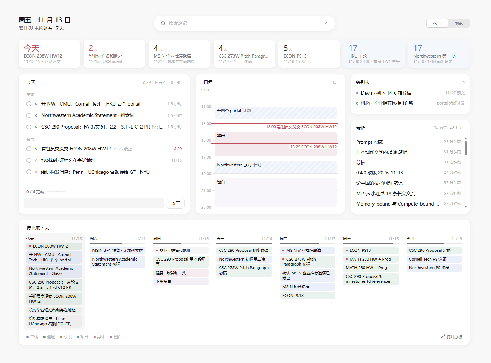
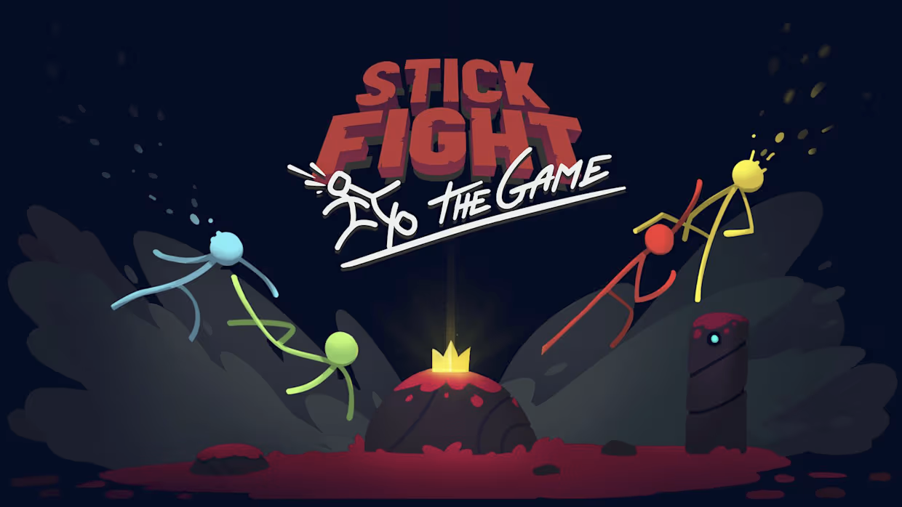

## 在做的事

这周整理了很多之前的档案，回顾了一下以前的作业 Project 之类的东西。

这是我 CSC 171 Intro to Programming 做的 Final Project，一个全部用 Java 写的简单的带 GUI 的 Blackjack 游戏，这还是 GPT 4 时代的东西：



别的大部分 course project 感觉都基本没印象了，都没啥意思。但我给每个 Project 都建立了档案，也生成了可视化。

---

做了很多申请相关的事务，然后升级了 obsidian-home 插件成了一个大的 dashboard 和 navigator：

申请的时候用 [Muse](https://muse.ai) 进行 browser use 还是很爽的，感觉 Muse 免费版的额度特别慷慨，几乎没有用完过。我开 20 个 subagent 去核对每个学校的推荐信要求也消耗不了多少额度。

最近还在用 Muse 帮我下单很多东西，以及对比商品价格，对比出行方式和价格，或者退订各种东西，整理邮件之类的。干这些事情要不断在各种浏览器页面之间跳来跳去，还要记住上下文，太消耗认知带宽了。用 Muse 之后就说几句话就 OK 了。它确实最适合做订机票之类的事情。

---

这周一直在思考和研究我的 CSC 290 的 Final Project 应该怎么做。我是想基于 FlashAttention 加速我的 meeting-transcriber 工具的转录。我花了蛮长时间研究 CTranslate2，fast-whisper，以及 Attention 和 FlashAttention 的。看你过两天会把我在这过程中写的 note publish 到网站上。

---

## 想法



BLG 竟然赢了。我已经不知道该说些什么好了。感觉表达什么都会显得幼稚。

我有时候会思考，电竞它到底有什么意义呢？因为我回顾我以前玩了这么久的 LOL 和 Apex，却感觉没有留下太多东西。它无法给人带来进步，也无法像单机游戏一样获得新奇又丰富的体验。那它到底有啥用呢？

但是看完这次比赛，我又想起来快十年之前看 S8 的 IG 的时候激动的自己了。那是我对英雄联盟有十足热情的一段时间。一直以来我总是轻视过去的自己，觉得现在的自己总是更成熟。但是我现在开始意识到，过去的自己也曾经拥有一种今天无法替代的生命力。我竟然已经接触并熟悉 LOL 这么久了。我觉得这次夺冠的那个瞬间是对那过往的历史，那些年份和陪伴画上句号的一个瞬间。它当然有容量承载万千碧螺春，乃至万千英雄联盟玩家的感情。这些并不一定需要有多少功利的作用。

---

突然意识到这段时间实在是把碎片时间塞得太满，基本上都没有自由时间，或者说好好放松休息的时间，每一刻每一秒都在思考到底要做些什么事情才能提高生产力，或者说做点什么有生产力的事情。而且我已经很久没有稍微专注地进行阅读，或者说看点自己想看的东西、玩点自己想玩的游戏什么的了，时间全部被各种莫名其妙的东西占用。这种感觉真的太难受了。

这周末好好休息了一下，感觉恢复了一些。

---

读 *[ある高校の哲学的な一日](https://ch.nicovideo.jp/wakusei2nd/blomaga/ar535439)* 有感：

色情越是依赖淫荡、羞辱和物化来吸引和刺激消费者，就越容易受到社会鄙视，同时这种鄙视又让整个色情文化更加难以正常化，形成恶性循环。但现实就是这样。社会就是这种恶劣的风气，导致一旦女性从事过色情活动，那她将永远也无法摘下这个标签，因为总会有男人不断地对这些事进行复读。

性欲本身没有原罪，然而围绕性欲形成的某些文化、商业和人际关系中普遍存在物化、剥削、羞辱与权力不平等，并且男性通过对女性的性占有和支配来证明自身地位的权力叙事在其中更是普遍得不能再普遍。

这种叙事本质上是男性中心主义的：表面上围绕女性的身体和性展开，真正的权力竞争却发生在男性之间。一个男性通过征服女性获得优越感，另一个男性则因女性（像资源或物品一样）被“夺走”而蒙受羞辱。女性在其中失去了主体性，沦为男性衡量彼此地位、争夺优越感的工具。

这种将女性物化与男性之间的地位竞争结合起来，并从中获取性快感的 toxic masculinity 竟然还在这个世界上被普遍认可，真的令我不可思议。

---

## 生活

- 感恩节已经确定要去纽约了。纽约我又来了！我已经迫不及待掏 100 刀剪头发了。
- 感觉身材正在缓慢地变好中。。好想我的肌肉快快膨胀啊。。
- 第一次玩 [Stick Fight](https://landfall.se/stickfightthegame)，这游戏好好玩啊我发现。但这应该也是那种可能一周玩个一次最多了的游戏。
  
- [The Melon Music Awards 2026 (MMA)](https://www.melon.com/mma/2026/) 的芙礼稞真的给我美哭了啊
  
  
  
